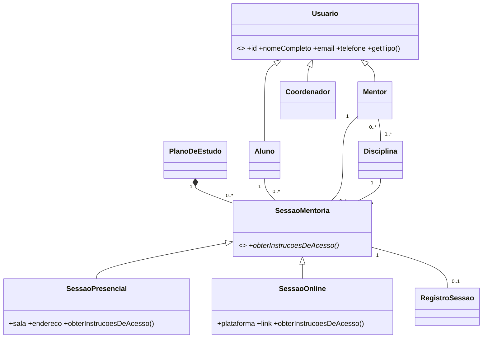

# Diagrama de classes

`Usuario` e `SessaoMentoria` são classes abstratas. A segunda declara `obterInstrucoesDeAcesso`, implementado de forma diferente pelas subclasses presenciais e online. Uma sessão pode ficar sem plano; quando associada, integra a composição 1:N e é removida se o plano for excluído.
