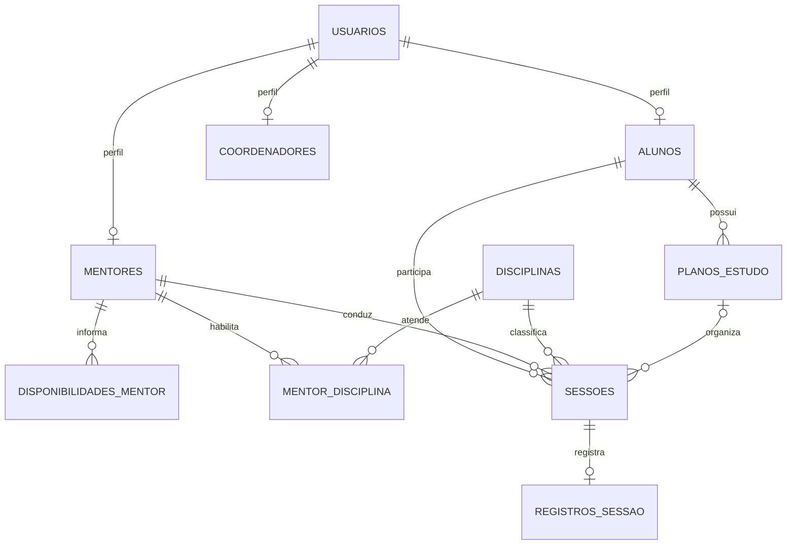

# Diagrama de entidade e relacionamento

O SQL completo está em `database/schema.sql`. A regra de conflito compara intervalos na camada de serviço e bloqueia a linha do mentor durante a transação. Uma chave única em mentor, data e hora inicial não detectaria sobreposições com durações diferentes.
